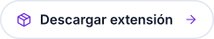
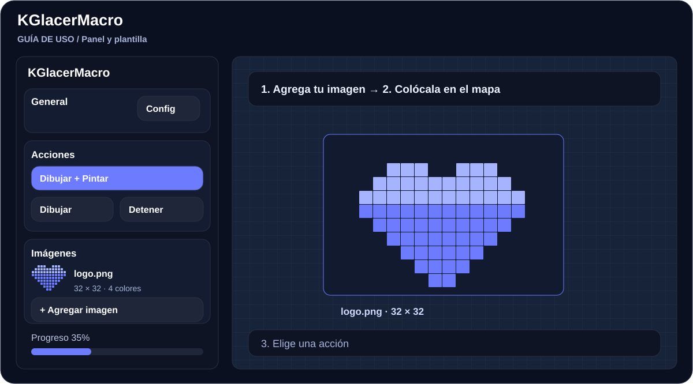
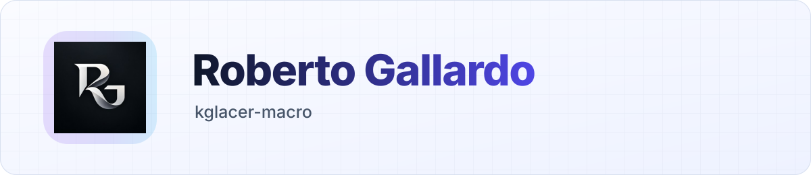

<!-- kit:lang -->

<a href="README.md"><picture><source media="(prefers-color-scheme: dark)" srcset="assets/readme-builder/kit/lang-es-01-dark.svg" /></picture></a>&nbsp;
<a href="README.es.md"><picture><source media="(prefers-color-scheme: dark)" srcset="assets/readme-builder/kit/lang-es-02-dark.svg" /></picture></a>

<!-- /kit:lang -->

<h1 align="center">KGlacerMacro</h1>

<!-- kit:hero -->

<picture><source media="(prefers-color-scheme: dark)" srcset="assets/readme-builder/kit/hero-es-dark.svg" /></picture>

<!-- /kit:hero -->

<!-- kit:nav -->

<a href="#install"><picture><source media="(prefers-color-scheme: dark)" srcset="assets/readme-builder/kit/nav-es-01-dark.svg" /></picture></a>&nbsp;
<a href="#updates"><picture><source media="(prefers-color-scheme: dark)" srcset="assets/readme-builder/kit/nav-es-02-dark.svg" /></picture></a>&nbsp;
<a href="#companion"><picture><source media="(prefers-color-scheme: dark)" srcset="assets/readme-builder/kit/nav-es-03-dark.svg" /></picture></a>&nbsp;
<a href="#help"><picture><source media="(prefers-color-scheme: dark)" srcset="assets/readme-builder/kit/nav-es-04-dark.svg" /></picture></a>

<!-- /kit:nav -->

Carga tus imágenes, organiza plantillas y trabaja desde un solo panel. Instálalo una vez y se mantiene actualizado solo.

<!-- kit:downloads -->

<a href="https://raw.githubusercontent.com/robgallardof/kglacer-macro-dist/main/loader.user.js"><picture><source media="(prefers-color-scheme: dark)" srcset="assets/readme-builder/kit/downloads-es-01-dark.svg" /></picture></a>&nbsp;
<a href="https://releases.robertogallardo.dev/latest/kglacer-input-companion.zip"><picture><source media="(prefers-color-scheme: dark)" srcset="assets/readme-builder/kit/downloads-es-02-dark.svg" /></picture></a>&nbsp;
<a href="https://chromewebstore.google.com/detail/gcalenpjmijncebpfijmoaglllgpjagf"><picture><source media="(prefers-color-scheme: dark)" srcset="assets/readme-builder/kit/downloads-es-03-dark.svg" /></picture></a>

<!-- /kit:downloads -->

La ilustración muestra un ejemplo de diseño; no es una captura de una sesión real.

<!-- kit:wave -->

<!-- /kit:wave -->

<!-- kit:h-install -->

<picture><source media="(prefers-color-scheme: dark)" srcset="assets/readme-builder/kit/h-install-es-dark.svg" /></picture>

<!-- /kit:h-install -->

1. Usa un **navegador Chromium de escritorio**: Chrome, Edge, Brave, Opera / Opera GX o Vivaldi.
2. Instala **[Tampermonkey Beta](https://chromewebstore.google.com/detail/gcalenpjmijncebpfijmoaglllgpjagf)**.
3. Abre la página de extensiones de tu navegador, entra en **Detalles** de Tampermonkey y activa **Permitir secuencias de comandos de usuario** (*Allow User Scripts*, Chrome 138 o posterior):

<!-- kit:browser-pages -->

<a href="chrome://extensions"><picture><source media="(prefers-color-scheme: dark)" srcset="assets/readme-builder/kit/browser-pages-es-01-dark.svg" /></picture></a>&nbsp;
<a href="edge://extensions"><picture><source media="(prefers-color-scheme: dark)" srcset="assets/readme-builder/kit/browser-pages-es-02-dark.svg" /></picture></a>&nbsp;
<a href="opera://extensions"><picture><source media="(prefers-color-scheme: dark)" srcset="assets/readme-builder/kit/browser-pages-es-03-dark.svg" /></picture></a>&nbsp;
<a href="vivaldi://extensions"><picture><source media="(prefers-color-scheme: dark)" srcset="assets/readme-builder/kit/browser-pages-es-04-dark.svg" /></picture></a>

<!-- /kit:browser-pages -->

4. Haz clic en **[Instalar KGlacerMacro](https://raw.githubusercontent.com/robgallardof/kglacer-macro-dist/main/loader.user.js)** y luego en **Instalar** en la página de Tampermonkey.

Recarga la página del mapa. La primera vez se descarga la versión actual; después arranca al instante desde la copia verificada en tu navegador.

> **¿Ya usabas KGlacerMacro?** Tampermonkey mostrará **Actualizar** en lugar de Instalar. Se conservan tus imágenes, plantillas y ajustes.

No funciona en Firefox, Safari ni en móviles.

<!-- kit:wave -->

<!-- /kit:wave -->

<!-- kit:h-updates -->

<picture><source media="(prefers-color-scheme: dark)" srcset="assets/readme-builder/kit/h-updates-es-dark.svg" /></picture>

<!-- /kit:h-updates -->

Las versiones nuevas se descargan en segundo plano. Cuando una está lista, la página muestra **"KGlacerMacro … está listo. Recarga la página para usarlo."** Recarga cuando te convenga.

El instalador (`loader.user.js`) casi nunca cambia; Tampermonkey lo mantiene al día desde este repositorio.

<!-- kit:wave -->

<!-- /kit:wave -->

<!-- kit:h-companion -->

<picture><source media="(prefers-color-scheme: dark)" srcset="assets/readme-builder/kit/h-companion-es-dark.svg" /></picture>

<!-- /kit:h-companion -->

La entrada automática usa la extensión opcional **KGlacer Input Companion**. Descárgala con **[Descargar extensión](https://releases.robertogallardo.dev/latest/kglacer-input-companion.zip)** (siempre la versión actual) o con el botón **Descargar ZIP de la extensión** del panel.

1. Descomprímela, abre la página de extensiones, activa el **Modo de desarrollador** y pulsa **Cargar descomprimida**.
2. Elige la carpeta `kglacer-input-companion` que contiene `manifest.json`.
3. En la pestaña del mapa, haz clic en el icono de la extensión para activar la entrada en esa pestaña.
4. En el panel, entra en **Config** y pulsa **Probar conexión**.

<!-- kit:wave -->

<!-- /kit:wave -->

<!-- kit:h-help -->

<picture><source media="(prefers-color-scheme: dark)" srcset="assets/readme-builder/kit/h-help-es-dark.svg" /></picture>

<!-- /kit:h-help -->

| Lo que ves | Qué hacer |
| --- | --- |
| "No se pudo verificar ni descargar" | No se ejecutó nada sin verificar. Revisa tu conexión y recarga. |
| "necesita el loader … o posterior" | Tampermonkey → Panel → KGlacerMacro → **Buscar actualizaciones**. |
| "Se rechazó una versión anterior" | No hay que hacer nada: sigues con la versión verificada que ya tenías. |
| No pasa nada en la página del mapa | Revisa que **Permitir secuencias de comandos de usuario** esté activo y que el script esté habilitado en Tampermonkey. |
| Sigue sin funcionar | Pulsa F12 e incluye en tu reporte las líneas de la consola que empiezan con `[KGM][Loader]`. |

<!-- kit:support -->

<a href="https://github.com/robgallardof/kglacer-macro-dist/issues"><picture><source media="(prefers-color-scheme: dark)" srcset="assets/readme-builder/kit/support-es-01-dark.svg" /></picture></a>&nbsp;
<a href="NOTICE.md"><picture><source media="(prefers-color-scheme: dark)" srcset="assets/readme-builder/kit/support-es-02-dark.svg" /></picture></a>

<!-- /kit:support -->

<!-- kit:wave -->

<!-- /kit:wave -->

<!-- kit:back -->

<a href="#top"><picture><source media="(prefers-color-scheme: dark)" srcset="assets/readme-builder/kit/back-es-01-dark.svg" /></picture></a>

<!-- /kit:back -->

<a href="https://github.com/robgallardof"><picture><source media="(prefers-color-scheme: dark)" srcset="assets/readme/brand/signature-es-dark.svg" /></picture></a>

