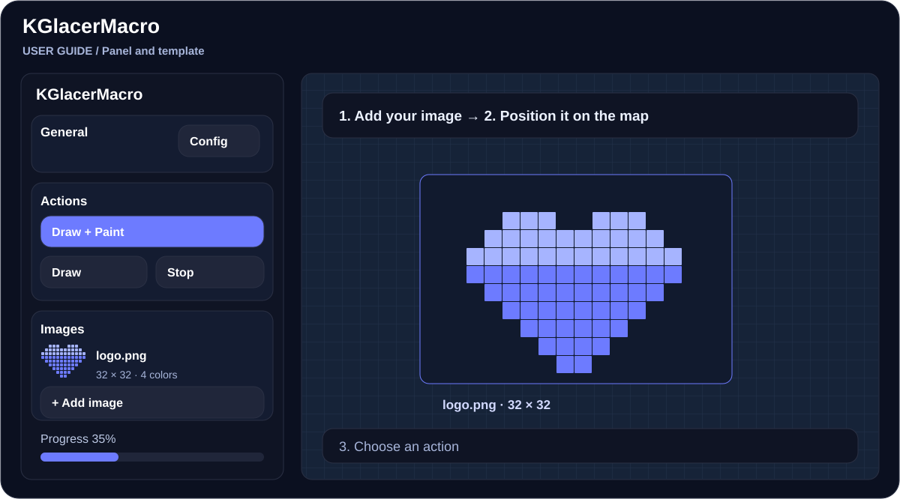
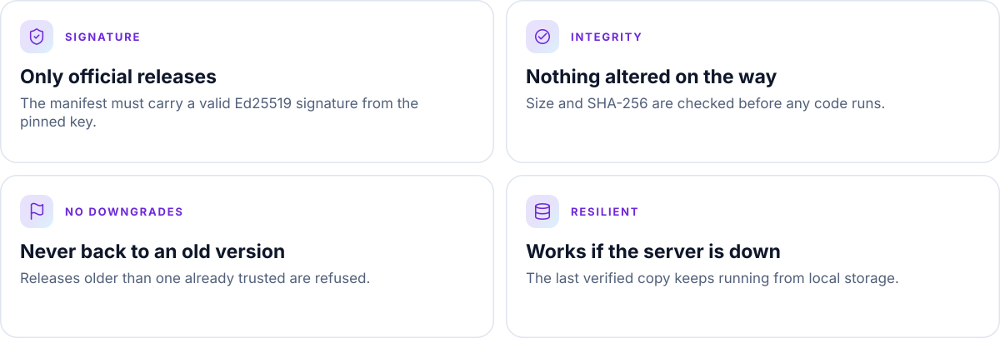
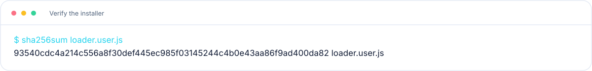
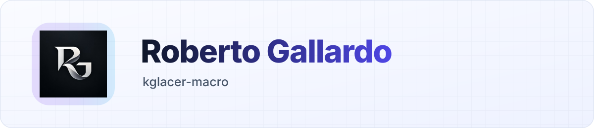

<!-- kit:lang -->

<a href="README.md"><picture><source media="(prefers-color-scheme: dark)" srcset="assets/readme-builder/kit/lang-en-01-dark.svg" /></picture></a>&nbsp;
<a href="README.es.md"><picture><source media="(prefers-color-scheme: dark)" srcset="assets/readme-builder/kit/lang-en-02-dark.svg" /></picture></a>

<!-- /kit:lang -->

<h1 align="center">KGlacerMacro</h1>

<!-- kit:hero -->

<picture><source media="(prefers-color-scheme: dark)" srcset="assets/readme-builder/kit/hero-en-dark.svg" /></picture>

<!-- /kit:hero -->

<!-- kit:nav -->

<a href="#install"><picture><source media="(prefers-color-scheme: dark)" srcset="assets/readme-builder/kit/nav-en-01-dark.svg" /></picture></a>&nbsp;
<a href="#updates"><picture><source media="(prefers-color-scheme: dark)" srcset="assets/readme-builder/kit/nav-en-02-dark.svg" /></picture></a>&nbsp;
<a href="#companion"><picture><source media="(prefers-color-scheme: dark)" srcset="assets/readme-builder/kit/nav-en-03-dark.svg" /></picture></a>&nbsp;
<a href="#security"><picture><source media="(prefers-color-scheme: dark)" srcset="assets/readme-builder/kit/nav-en-04-dark.svg" /></picture></a>&nbsp;
<a href="#help"><picture><source media="(prefers-color-scheme: dark)" srcset="assets/readme-builder/kit/nav-en-05-dark.svg" /></picture></a>

<!-- /kit:nav -->

Load your images, organize templates and work on [wplace.live](https://wplace.live) from one panel. This repository hosts the **official signed installer**: it downloads each release, checks its signature and only then runs it.

<!-- kit:downloads -->

<a href="https://raw.githubusercontent.com/robgallardof/kglacer-macro-dist/main/loader.user.js"><picture><source media="(prefers-color-scheme: dark)" srcset="assets/readme-builder/kit/downloads-en-01-dark.svg" /></picture></a>&nbsp;
<a href="https://chromewebstore.google.com/detail/gcalenpjmijncebpfijmoaglllgpjagf"><picture><source media="(prefers-color-scheme: dark)" srcset="assets/readme-builder/kit/downloads-en-02-dark.svg" /></picture></a>

<!-- /kit:downloads -->

<!-- kit:facts -->

<picture><source media="(prefers-color-scheme: dark)" srcset="assets/readme-builder/kit/facts-en-dark.svg" /></picture>

<!-- /kit:facts -->

The illustration shows an example layout; it is not a screenshot of a live session.

<!-- kit:wave -->

<!-- /kit:wave -->

<!-- kit:h-install -->

<picture><source media="(prefers-color-scheme: dark)" srcset="assets/readme-builder/kit/h-install-en-dark.svg" /></picture>

<!-- /kit:h-install -->

1. Use a **desktop Chromium browser**: Chrome, Edge, Brave, Opera / Opera GX or Vivaldi.
2. Install **[Tampermonkey Beta](https://chromewebstore.google.com/detail/gcalenpjmijncebpfijmoaglllgpjagf)**.
3. Open your browser's extensions page, click **Details** on Tampermonkey and turn on **Allow User Scripts** (Chrome 138 and newer):

<!-- kit:browser-pages -->

<a href="chrome://extensions"><picture><source media="(prefers-color-scheme: dark)" srcset="assets/readme-builder/kit/browser-pages-en-01-dark.svg" /></picture></a>&nbsp;
<a href="edge://extensions"><picture><source media="(prefers-color-scheme: dark)" srcset="assets/readme-builder/kit/browser-pages-en-02-dark.svg" /></picture></a>&nbsp;
<a href="opera://extensions"><picture><source media="(prefers-color-scheme: dark)" srcset="assets/readme-builder/kit/browser-pages-en-03-dark.svg" /></picture></a>&nbsp;
<a href="vivaldi://extensions"><picture><source media="(prefers-color-scheme: dark)" srcset="assets/readme-builder/kit/browser-pages-en-04-dark.svg" /></picture></a>

<!-- /kit:browser-pages -->

4. Click **[Install KGlacerMacro](https://raw.githubusercontent.com/robgallardof/kglacer-macro-dist/main/loader.user.js)** and then **Install** on the Tampermonkey page.

Open or reload [wplace.live](https://wplace.live). The first load downloads the current release; later loads start instantly from the verified copy in your browser.

> **Already using KGlacerMacro?** Tampermonkey shows **Update** instead of Install. Your images, templates and settings are kept.

Firefox, Safari and mobile browsers are not supported.

<!-- kit:wave -->

<!-- /kit:wave -->

<!-- kit:h-updates -->

<picture><source media="(prefers-color-scheme: dark)" srcset="assets/readme-builder/kit/h-updates-en-dark.svg" /></picture>

<!-- /kit:h-updates -->

New versions download in the background. When one is ready, the page shows **"KGlacerMacro … is ready. Reload the page to use it."** Reload whenever it suits you.

The installer itself (`loader.user.js`) rarely changes; Tampermonkey keeps it up to date from this repository.

<!-- kit:wave -->

<!-- /kit:wave -->

<!-- kit:h-companion -->

<picture><source media="(prefers-color-scheme: dark)" srcset="assets/readme-builder/kit/h-companion-en-dark.svg" /></picture>

<!-- /kit:h-companion -->

Automatic input uses the optional **KGlacer Input Companion**. The panel's **Download extension ZIP** button always matches your release.

1. Unzip it, open the extensions page, enable **Developer mode** and click **Load unpacked**.
2. Select the `kglacer-input-companion` folder that contains `manifest.json`.
3. On the wplace.live tab, click the extension icon to turn input on for that tab.
4. In the panel, go to **Config** and click **Test connection**.

<!-- kit:wave -->

<!-- /kit:wave -->

<!-- kit:h-security -->

<picture><source media="(prefers-color-scheme: dark)" srcset="assets/readme-builder/kit/h-security-en-dark.svg" /></picture>

<!-- /kit:h-security -->

Every official release is signed with the maintainer's key. The installer pins the public key (its id is in the script header) and checks every release on your machine before running it.

<!-- kit:protections -->

<picture><source media="(prefers-color-scheme: dark)" srcset="assets/readme-builder/kit/protections-en-dark.svg" /></picture>

<!-- /kit:protections -->

If a check fails, **nothing is run** and you see a short message. The installer is deliberately not minified, so you can read exactly what it does.

Signing proves where a release comes from and that it was not altered. It does **not** hide the code: everything that runs in your browser can be inspected.

Every release note lists the installer's SHA-256. Compare it with your copy (`certutil -hashfile loader.user.js SHA256` on Windows):

<!-- kit:verify -->

<picture><source media="(prefers-color-scheme: dark)" srcset="assets/readme-builder/kit/verify-en-dark.svg" /></picture>

<!-- /kit:verify -->

<!-- kit:wave -->

<!-- /kit:wave -->

<!-- kit:h-data -->

<picture><source media="(prefers-color-scheme: dark)" srcset="assets/readme-builder/kit/h-data-en-dark.svg" /></picture>

<!-- /kit:h-data -->

KGlacerMacro signs you in through its Control API and, as stated in the script metadata, syncs your wplace session token (`j`) through it. Only install it if you accept that.

<!-- kit:wave -->

<!-- /kit:wave -->

<!-- kit:h-help -->

<picture><source media="(prefers-color-scheme: dark)" srcset="assets/readme-builder/kit/h-help-en-dark.svg" /></picture>

<!-- /kit:h-help -->

| What you see | What to do |
| --- | --- |
| "could not be verified or downloaded" | Nothing unverified was run. Check your connection and reload. |
| "needs loader … or newer" | Tampermonkey → Dashboard → KGlacerMacro → **Check for updates**. |
| "An older release … was rejected" | Nothing to do: you keep the verified release you already have. |
| Nothing happens on wplace.live | Check that **Allow User Scripts** is on and the script is enabled in Tampermonkey. |
| Still stuck | Press F12 and include the console lines starting with `[KGM][Loader]` in your report. |

<!-- kit:support -->

<a href="https://github.com/robgallardof/kglacer-macro-dist/issues"><picture><source media="(prefers-color-scheme: dark)" srcset="assets/readme-builder/kit/support-en-01-dark.svg" /></picture></a>&nbsp;
<a href="NOTICE.md"><picture><source media="(prefers-color-scheme: dark)" srcset="assets/readme-builder/kit/support-en-02-dark.svg" /></picture></a>

<!-- /kit:support -->

<!-- kit:wave -->

<!-- /kit:wave -->

<!-- kit:back -->

<a href="#top"><picture><source media="(prefers-color-scheme: dark)" srcset="assets/readme-builder/kit/back-en-01-dark.svg" /></picture></a>

<!-- /kit:back -->

<a href="https://github.com/robgallardof"><picture><source media="(prefers-color-scheme: dark)" srcset="assets/readme/brand/signature-es-dark.svg" /></picture></a>

